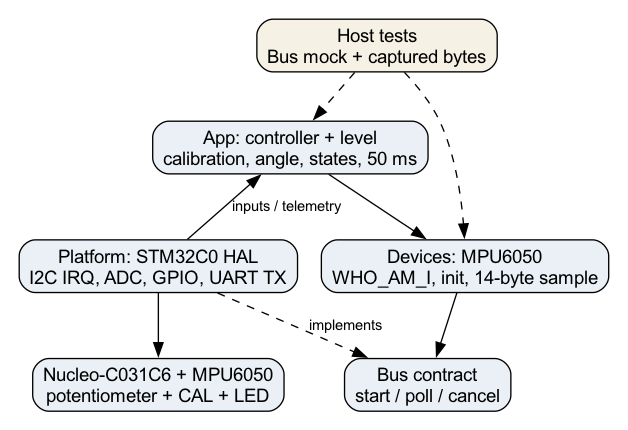

# Архітектура та контракти

| Шар | Файли | Відповідальність і залежності |
|---|---|---|
| App | controller.c, level.c | Планування 50 мс, калібрування, кут, стани, backoff; лише Devices API і стандартна C |
| Devices | mpu6050.c, bus.h | WHO_AM_I, конфігурація, signed big-endian дані; асинхронний Bus без HAL |
| Platform | platform.c, board.h | HAL I2C IRQ, ADC, GPIO, UART TX; реалізація Bus |
| Core | main.c, IRQ/MSP | Clock 48 МГц, init периферії, виклик Platform; HAL STM32C0 |

Bus передає 7-бітну адресу; Platform зсуває її один раз для HAL. Контракт start/poll/cancel повертає BUS_PENDING, OK, NACK, TIMEOUT, ERROR або BUSY. Буфери драйвера живуть до завершення; deadline 10 мс перевіряється без блокування. BUSY теж обмежений 10 мс. Після помилки контролер скидає калібрування й через 1000 мс повторює init 0x68.

У Platform читання складається з IRQ-передачі номера регістра, STOP і окремого IRQ-приймання. Це перевірений Wokwi шлях. Sequential HAL із repeated START у цій моделі давав SIZE=64 і timeout; роботу такого режиму не заявлено. TXIE/RXIE маскуються після XferCount=0 до STOP, щоб уникнути зайвих data IRQ. Буфер UART зберігається до Tx complete, новий рядок пропускається, якщо попередній зайнятий. Main не викликає HAL_Delay або printf.

ADC працює у fixed sequencer single-channel, EOC опитується без очікування; timeout 5 мс спричиняє недійсне ADC і ERROR. Короткий CAL після 30 мс debounce збирає 20 стабільних нормованих відліків. Норма поза 0,85..1,15 g відкидається; рух понад 0,02 між сусідніми нормованими векторами скидає накопичення. Кут до еталона обчислюється через acos після фільтра α=0,25. ADC задає 500 + code×4500/4095 mdeg. Гістерезис 200 mdeg, витримка переходу 300 мс, stale >250 мс. Утримання CAL 2 с запускає один діагностичний запит 0x69 до відпускання.

| Стан | LED |
|---|---|
| UNCAL | Вимкнений |
| CAL | Перемикання кожні 100 мс |
| LEVEL | Увімкнений |
| TILT | Перемикання кожні 500 мс |
| ERROR | Перемикання кожні 125 мс |

Обчислення відносного нахилу за гравітацією не визначає yaw. Поступальне прискорення, шум і температурний дрейф реального MPU6050 не оцінено. Калібрування еталона в RAM не зберігається після перезапуску.

## HAL і регенерація

ADC потрібен потенціометру, I2C MPU6050, UART телеметрії, GPIO кнопці/LED/markers, RCC/PWR/FLASH налаштовують clock і latency, CORTEX обслуговує SysTick/NVIC. DMA збережено як залежність типів і helper API HAL I2C/UART, але канали та DMA-запити не використовуються. Невикористаний HAL EXTI вимкнено, його source виключено зі збірки; HEX при цьому залишився ідентичним захопленій версії. SPI/TIM/RTC не ввімкнено.

Власні App/Devices/Platform відокремлені від CubeMX. Main викликає bench_init/bench_step у USER CODE; частина ADC init і MSP підтримується вручну разом із IOC. Автоматичну повторну генерацію не виконано; вона потребує порівняння diff, відновлення власних IRQ у Platform і повторного check_contracts.py. Сам IOC не гарантує збереження всіх ручних змін.

Coverage gate 90% рядків обрано для невеликих чистих модулів, де більшість поведінки має виконуватися host-тестами. Фактичні 99% перевищують gate; захисні фази й невиконані branches лишаються видимими. Це не gate для HAL/Platform і не доказ повноти специфікації.
